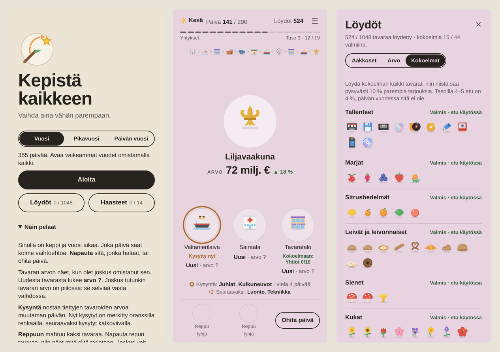

# Kepistä kaikkeen

Selaimessa pelattava vaihtopeli. Aloitat kepillä, vaihdat joka päivä vähän parempaan ja yrität omistaa *kaiken* ennen kuin vuosi loppuu.

**[Pelaa selaimessa →](https://sampomustonen-png.github.io/keppi/)**



## Pelistä lyhyesti

- Joka päivä saat kolme vaihtotarjousta. Valitse yksi tai ohita päivä.
- Tavaroita on 1 048, ja ne on jaettu 19 portaaseen kepistä aina *Kaikkeen* asti. Jokaisella tavaralla on oma piirretty kuva.
- **Kysyntä** nostaa tiettyjen tavaroiden arvoa muutaman päivän ajan. Seuraavaksi kysytyt aiheet näkyvät etukäteen.
- **Repussa** voi säilyttää kaksi tavaraa. Niillä voi tehdä omia kauppojaan tai yhdistää ne yhdeksi arvokkaammaksi.
- **Arvo ?:** uuden tavaran arvoa ei näe etukäteen, ja joskus tutunkin tavaran arvo selviää vasta vaihdossa. Ruoka pilaantuu, jos sitä säilyttää liian kauan.
- **Kokoelmat:** löydä kokoelman kaikki tavarat, niin saat niistä jatkossa 10 % parempia tarjouksia (vaikeimmilla tasoilla 4 %).
- **Haasteet:** 14 pientä tavoitetta, esimerkiksi voitto ilman paketteja tai seitsemän päivän putki.

### Pelimuodot

| Muoto | Kesto | Kuvaus |
|---|---|---|
| Vuosi | 260–365 päivää | Viisi vaikeustasoa. Seuraava taso avautuu, kun voitat edellisen. |
| Pikavuosi | 100 päivää | Nopeampi peli: kysyntä vaihtuu tiuhaan ja ruoka pilaantuu nopeasti. |
| Päivän vuosi | 100 päivää | Kaikki pelaavat saman päivän samoilla tarjouksilla. Tuloksen voi jakaa tekstinä tai kuvana, ja peräkkäiset päivät kasvattavat putkea. |

Peli tallentuu selaimeen. Valikon kohdasta *Siirrä peli toiseen laitteeseen* saat siirtokoodin, jolla edistyminen siirtyy toiseen selaimeen.

## Kehitys

Tarvitset Node.js:n (vähintään versio 18). Pelissä ei ole riippuvuuksia, joten `npm install` ei ole tarpeen.

```sh
npm run build        # rakentaa dist/index.html:n (yksi tiedosto, kaikki kuvat ja fontti mukana)
npm test             # moottorin, sisällön ja vaikeustasojen testit
npm run serve        # tarjoilee dist/-kansion osoitteessa http://127.0.0.1:8765
```

Muut komennot:

```sh
npm run sim          # mittaa voittoprosentit tasoittain (300 peliä per taso)
npm run sim:modes    # pikavuosi ja kokoelmaetujen vaikutus
npm run tune         # hakee vaikeustasoille sopivat arvot
node art/preview.js art/items/n4.txt esikatselu.html   # kuvien esikatselu
```

Selaintestit (`tools/qa/`) käyttävät Pythonia ja Playwrightia (`pip install playwright pillow`):

```sh
node tools/qa/gen_states.js   # tuottaa testitilat
python3 tools/qa/smoke.py     # savutesti: aloitus, pelimuodot, löydöt, haasteet, siirto
python3 tools/qa/overlap.py   # etsii päällekkäisiä tekstejä ja kuvia kahdeksalla näyttökoolla
python3 tools/qa/flow.py      # pelaa napautuksilla ja tarkistaa myös hetket ja loppunäkymän
python3 tools/qa/screenshot.py  # päivittää docs/screenshot.png:n
```

## Rakenne

```
src/
  items.txt        tavarat: nimi|emoji|arvo €|tagit|kuvaefekti
  families.txt     kokoelmat: nimi|tavaroiden tunnisteet
  data.js          lukee tavarat, portaat, muuntimet ja kokoelmat
  engine.js        pelimoottori ilman DOMia: deterministinen, testattava
  ui/              käyttöliittymä osina (ydin, kuvat ja äänet, piirto, löydöt, toiminnot, näkymät, jakaminen, käynnistys)
  template.html, style.css
art/
  draw.js          oma piirtokieli 64×64-kuvakkeille
  items/*.txt      tavaroiden kuvat (tunniste|piirros); aakkosjärjestyksessä viimeinen tiedosto voittaa
  mods.txt         muuntimien piirretyt kerrokset (kultainen, ruosteinen, jäätynyt …)
  ui.txt, app.txt  käyttöliittymän kuvat, logo ja sovelluskuvake
tools/
  build.js         kokoaa kaiken yhdeksi tiedostoksi dist/index.html
  sim/             tasapainotus: botit, voittoprosentit, viritys
  qa/              selaintestit
test/              node:test-testit (ajetaan GitHub Actionsissa)
```

### Uuden tavaran lisääminen

1. Lisää rivi tiedostoon `src/items.txt` oikean portaan kohdalle. Tunniste muodostuu nimestä: pienet kirjaimet, ä→a, ö→o, välit viivoiksi.
2. Piirrä kuva johonkin `art/items/`-kansion tiedostoon muodossa `tunniste|piirros`.
3. Voit lisätä tavaran kokoelmaan tiedostossa `src/families.txt`.
4. Aja `npm test`. Testi kertoo, jos kuva puuttuu tai kokoelmassa on tuntematon tunniste.

### Piirtokieli

Muodot erotetaan puolipisteellä. Värit ovat paletin kahden kirjaimen nimiä (`rd`, `gd`, `sk` …) tai `#hex`-arvoja. Läpinäkyvyyden saa jakoviivalla, esimerkiksi `wh/60`.

```
c cx cy r F              ympyrä
e cx cy rx ry F          ellipsi
r x y w h F [säde]       suorakaide
p F polku                täytetty polku (SVG-polku)
s F leveys polku         viiva
q F S leveys polku       täytetty polku ääriviivalla
sd F leveys viiva,väli polku   katkoviiva
o cx cy r F leveys       rengas
g kulma cx cy … /g       kierretty ryhmä
t dx dy [skaala] … /g    siirretty ryhmä
@makro(a,b,…)            valmiit osat: orb, planet, water, cloud, house, car, boat, fish …
@use(tunniste)           toisen tavaran kuva pohjaksi
```

Alkuun kirjoitettu `!` jättää maavarjon pois.

## Julkaisu

`.github/workflows/pages.yml` ajaa testit, rakentaa pelin ja julkaisee `dist/`-kansion GitHub Pagesiin jokaisen `main`-haaraan tulevan muutoksen jälkeen. Ota julkaisu käyttöön kerran: *Settings → Pages → Build and deployment → Source: GitHub Actions*. Vaihda sen jälkeen tämän tiedoston alussa olevaan pelilinkkiin oma käyttäjä- ja repositorionimesi.
